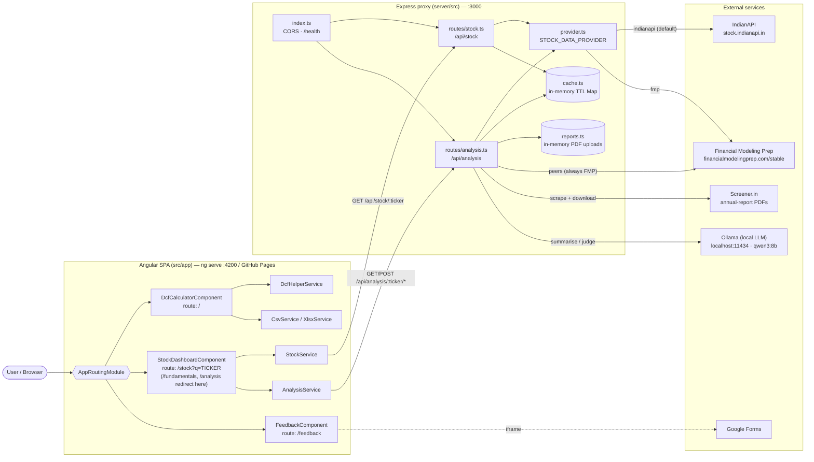
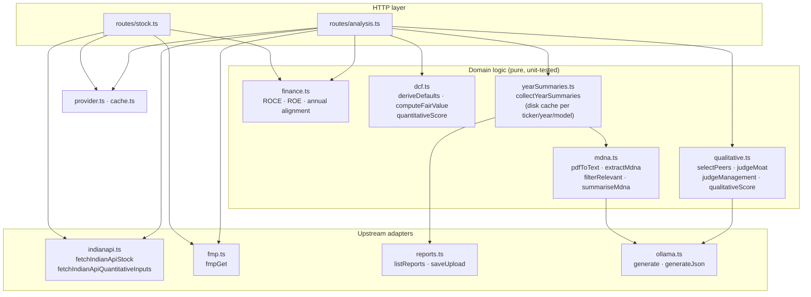
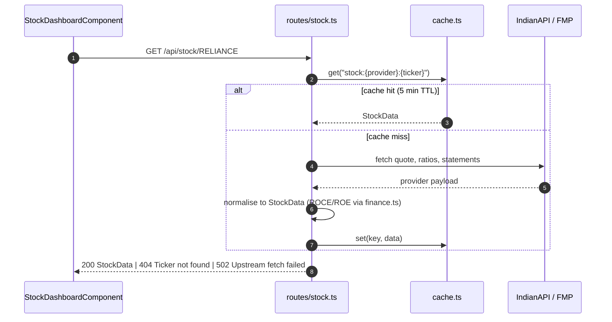
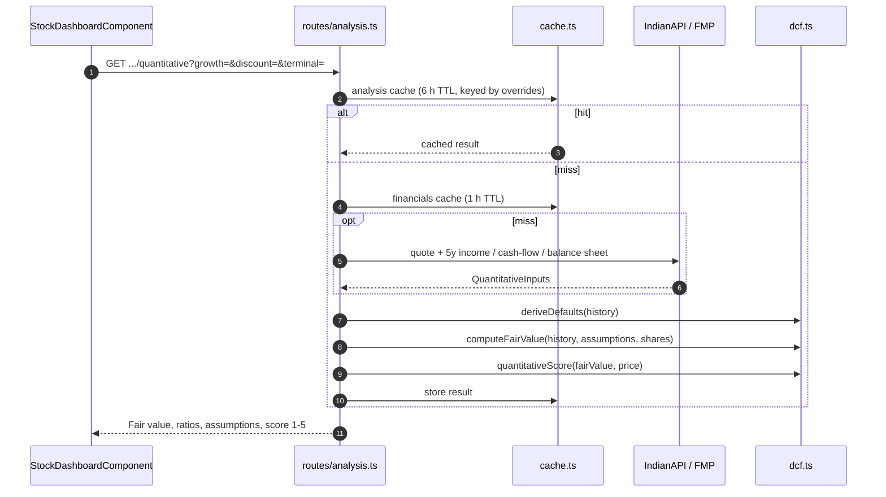
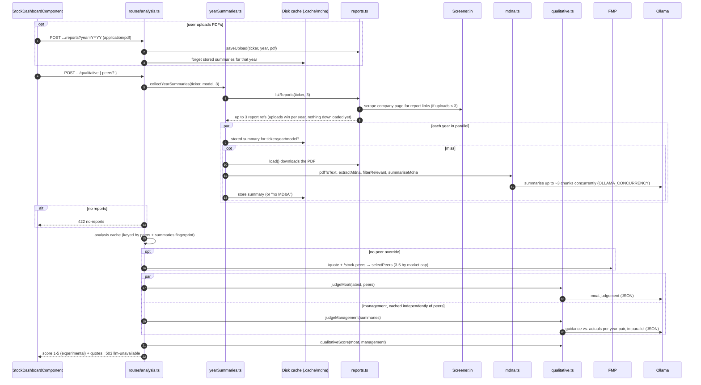

# System Architecture

DCF Stock Valuation has two parts: an **Angular 20 single-page app** and a **Node/Express proxy server**. The browser never calls third-party data APIs directly. The proxy keeps API keys server-side, normalises provider responses, caches results in memory, and runs the DCF and LLM-based analysis. Domain terms such as *Analysis*, *Fair value*, *Moat* and *Peer set* are defined in [CONTEXT.md](../CONTEXT.md).

## System overview

| Feature | Frontend | Backend | Data source |
| --- | --- | --- | --- |
| Manual DCF calculator with CSV/XLSX export | `DcfCalculatorComponent`, `DcfHelperService`, `CsvService`, `XlsxService` | — (runs entirely in the browser) | User input |
| Fundamentals (price, ratios, news, peers, consensus) | `StockDashboardComponent`, `StockService` | `GET /api/stock/:ticker` | IndianAPI or FMP |
| Quantitative analysis (DCF Fair value + score) | `StockDashboardComponent`, `AnalysisService` | `GET /api/analysis/:ticker/quantitative` | IndianAPI or FMP |
| Qualitative analysis (Moat + Management trustworthiness) | `StockDashboardComponent`, `AnalysisService` | `POST /api/analysis/:ticker/qualitative` | Screener.in / uploaded PDFs, FMP peers, Ollama |
| Feedback | `FeedbackComponent` | — | Embedded Google Form |

## Backend modules

## Request flows

### Fundamentals — `GET /api/stock/:ticker`

### Quantitative analysis — `GET /api/analysis/:ticker/quantitative`

### Qualitative analysis — `POST /api/analysis/:ticker/qualitative`

MD&A summaries of past annual reports never change, so they are stored on disk per ticker, year and model and reused across restarts. Bump `SUMMARY_VERSION` in `yearSummaries.ts` when extraction, filtering or the summary prompt changes. `filterRelevant` keeps at most ~30k characters of guidance, competitive-position and results passages per year (dropping macro-economic commentary, ESG metrics and tables), so each year needs about 3 summary calls.

## Configuration

Server environment variables are loaded from `server/.env` via `dotenv`.

| Variable | Default | Purpose |
| --- | --- | --- |
| `PORT` | `3000` | Proxy listen port |
| `STOCK_DATA_PROVIDER` | `indianapi` | `indianapi` or `fmp` for stock and quantitative data |
| `INDIANAPI_API_KEY` | — | IndianAPI key |
| `INDIANAPI_BASE_URL` | `https://stock.indianapi.in` | IndianAPI base URL |
| `FMP_API_KEY` | — | FMP key (also required for qualitative peer selection) |
| `FINANCIALS_TTL_MS` | `3600000` (1 h) | Cache TTL for raw financials |
| `ANALYSIS_TTL_MS` | `21600000` (6 h) | Cache TTL for computed analyses |
| `OLLAMA_URL` | `http://localhost:11434` | Ollama endpoint |
| `OLLAMA_MODEL` | `qwen3:8b` | Model used for MD&A summaries and judgements |
| `OLLAMA_NUM_CTX` | `8192` | Context window requested per Ollama call |
| `OLLAMA_CONCURRENCY` | `4` | Max in-flight Ollama requests from the proxy (pair with Ollama's `OLLAMA_NUM_PARALLEL`) |
| `MDNA_CACHE_DIR` | `server/.cache/mdna` | Directory for stored per-year MD&A summaries |

The frontend services hard-code the proxy at `http://localhost:3000`.

## Key design decisions and constraints

- **Proxy, not direct calls.** Keeps API keys out of the browser and lets the provider be swapped (`provider.ts`) without frontend changes.
- **NSE only.** Tickers are bare NSE symbols (an optional `.NS` suffix is accepted). Other exchange suffixes are rejected as not found.
- **Peer selection always uses FMP**, regardless of `STOCK_DATA_PROVIDER`.
- **All state is in process memory.** The response cache and uploaded PDFs are lost on restart and are not shared between instances.
- **Separate scores.** Quantitative and Qualitative scores are shown side by side and never blended. The Qualitative score is labelled experimental.
- **Local LLM.** The qualitative analysis depends on a reachable Ollama instance. If it is unreachable, the endpoint returns `503 llm-unavailable` and the rest of the app keeps working.

## Testing

| Layer | Tooling | Location |
| --- | --- | --- |
| Server unit tests | `node:test` via `tsx --test` | `server/src/*.test.ts` |
| Angular unit tests | Karma + Jasmine | `src/app/**/*.spec.ts` |
| End-to-end smoke | Playwright | `e2e/smoke.spec.ts` |
