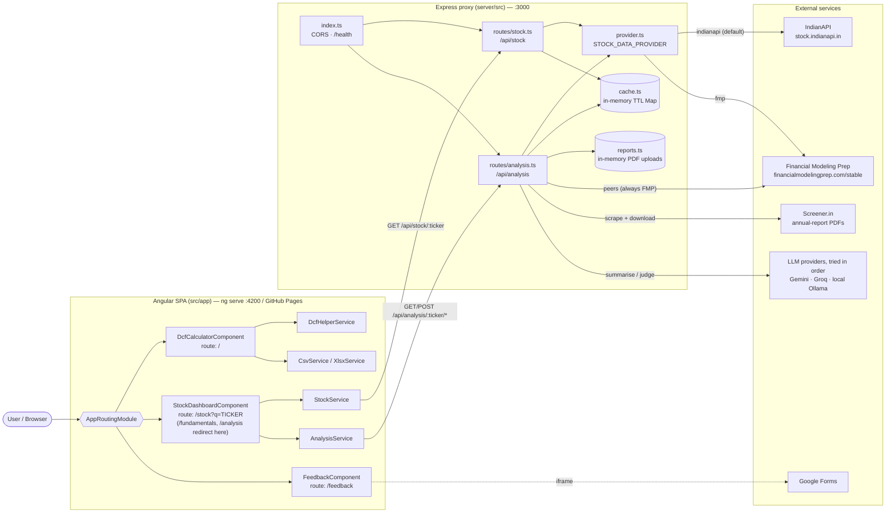
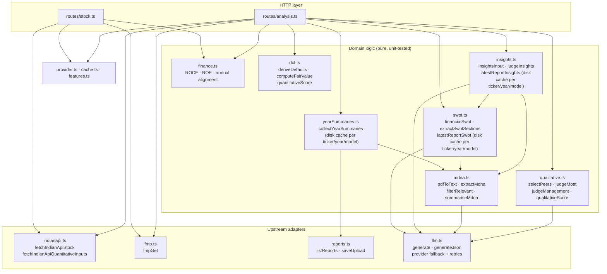
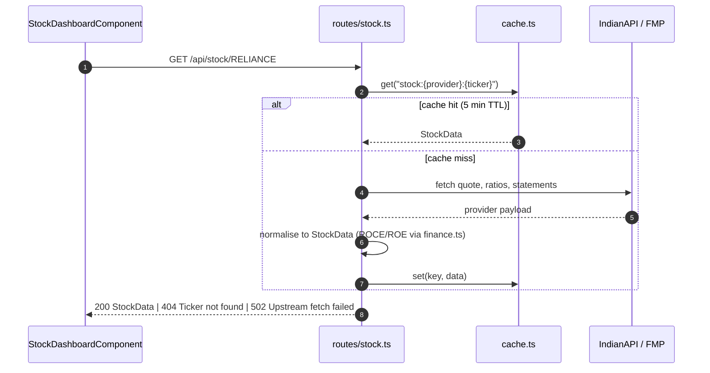
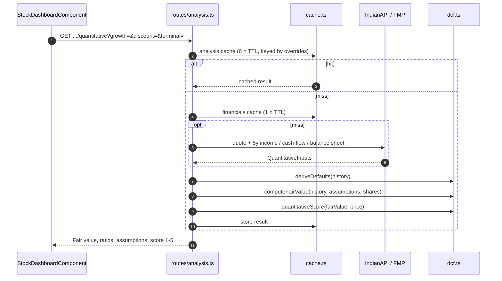
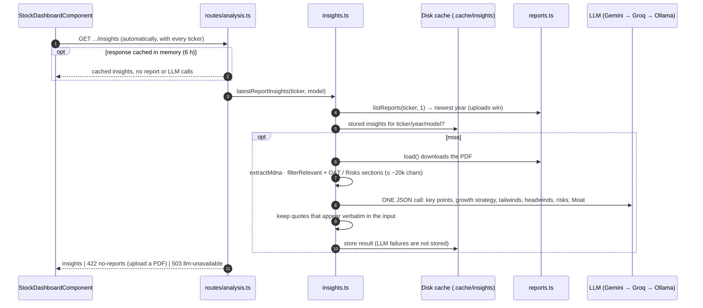
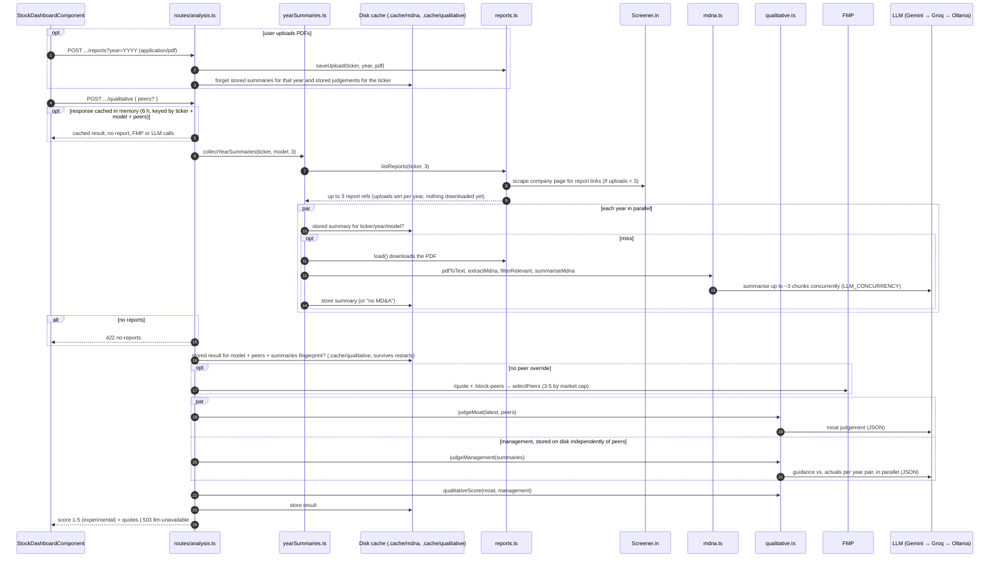
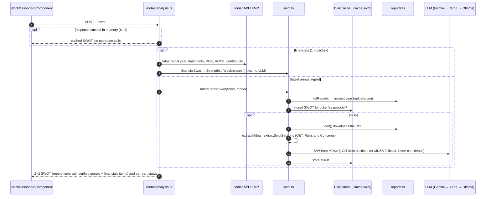

# System Architecture

DCF Stock Valuation has two parts: an **Angular 20 single-page app** and a **Node/Express proxy server**. The browser never calls third-party data APIs directly. The proxy keeps API keys server-side, normalises provider responses, caches results in memory, and runs the DCF and LLM-based analysis. Domain terms such as *Analysis*, *Fair value*, *Moat* and *Peer set* are defined in [CONTEXT.md](../CONTEXT.md).

## System overview

| Feature | Frontend | Backend | Data source |
| --- | --- | --- | --- |
| Manual DCF calculator with CSV/XLSX export | `DcfCalculatorComponent`, `DcfHelperService`, `CsvService`, `XlsxService` | — (runs entirely in the browser) | User input |
| Fundamentals (price, ratios, company context, peers) | `StockDashboardComponent`, `StockService` | `GET /api/stock/:ticker` | IndianAPI or FMP |
| Quantitative analysis (DCF Fair value + score) | `StockDashboardComponent`, `AnalysisService` | `GET /api/analysis/:ticker/quantitative` | IndianAPI or FMP |
| MD&A insights (key points, growth strategy, tailwinds, headwinds, risks, Moat; loads automatically) | `StockDashboardComponent`, `AnalysisService` | `GET /api/analysis/:ticker/insights` | Latest annual report (Screener.in / upload), one LLM call |
| Feature flags (which optional panels to show) | `StockDashboardComponent`, `AnalysisService` | `GET /api/analysis/features` | `ENABLE_QUALITATIVE`, `ENABLE_SWOT` |
| Qualitative analysis (Moat + Management trustworthiness; off unless `ENABLE_QUALITATIVE`) | `StockDashboardComponent`, `AnalysisService` | `POST /api/analysis/:ticker/qualitative` | Screener.in / uploaded PDFs, FMP peers, LLM |
| SWOT analysis (unscored, see [spec](spec-swot-analysis.md); off unless `ENABLE_SWOT`) | `StockDashboardComponent`, `AnalysisService` | `POST /api/analysis/:ticker/swot` | Latest annual report (Screener.in / upload), LLM, IndianAPI or FMP financials |
| Feedback | `FeedbackComponent` | — | Embedded Google Form |

## Backend modules

## Request flows

### Fundamentals — `GET /api/stock/:ticker`

### Quantitative analysis — `GET /api/analysis/:ticker/quantitative`

### MD&A insights — `GET /api/analysis/:ticker/insights`

The ~20k-character budget (~5k tokens) keeps the single request inside free-tier per-minute token limits. Bump `INSIGHTS_VERSION` in `insights.ts` when input selection or the prompt changes.

### Qualitative analysis — `POST /api/analysis/:ticker/qualitative`

Disabled unless `ENABLE_QUALITATIVE=true` (the endpoint returns `404 disabled`); it needs about 11 LLM calls per new ticker.

### SWOT analysis — `POST /api/analysis/:ticker/swot`

Disabled unless `ENABLE_SWOT=true` (the endpoint returns `404 disabled`).

The SWOT is a partial-result endpoint: if every LLM provider fails or no report is available, `report.status` explains why and the financials-based Strengths/Weaknesses are still returned. Bump `SWOT_VERSION` in `swot.ts` when section detection or the SWOT prompts change. A complete response (financials loaded, report analysed) is also cached in memory for `ANALYSIS_TTL_MS` (6 h) so repeat requests make no IndianAPI, report-listing or LLM calls; partial results are not cached, and uploading a report clears it.

MD&A summaries of past annual reports never change, so they are stored on disk per ticker, year and model and reused across restarts. Bump `SUMMARY_VERSION` in `yearSummaries.ts` when extraction, filtering or the summary prompt changes. `filterRelevant` keeps at most ~30k characters of guidance, competitive-position and results passages per year (dropping macro-economic commentary, ESG metrics and tables), so each year needs about 3 summary calls.

## Configuration

Server environment variables are loaded from `server/.env` via `dotenv`.

| Variable | Default | Purpose |
| --- | --- | --- |
| `PORT` | `3000` | Proxy listen port |
| `STOCK_DATA_PROVIDER` | `indianapi` | `indianapi` or `fmp` for stock and quantitative data |
| `INDIANAPI_API_KEY` | — | IndianAPI key |
| `INDIANAPI_BASE_URL` | `https://stock.indianapi.in` | IndianAPI base URL |
| `FMP_API_KEY` | — | FMP key (also required for qualitative peer selection) |
| `FINANCIALS_TTL_MS` | `3600000` (1 h) | Cache TTL for raw financials |
| `ANALYSIS_TTL_MS` | `21600000` (6 h) | Cache TTL for computed analyses |
| `ENABLE_QUALITATIVE` | `false` | Enables the 3-report Qualitative analysis endpoint and panel |
| `ENABLE_SWOT` | `false` | Enables the SWOT analysis endpoint and panel |
| `LLM_PROVIDERS` | keyed cloud providers, then `ollama` | Comma-separated order of `gemini`, `groq`, `ollama`; the next is tried when one fails |
| `LLM_CONCURRENCY` | `4` (or `OLLAMA_CONCURRENCY`) | Max in-flight LLM requests from the proxy; use 1–2 on free cloud tiers, pair with Ollama's `OLLAMA_NUM_PARALLEL` locally |
| `LLM_MAX_RETRIES` | `2` | Retries per provider on 429 / 5xx before falling back |
| `LLM_MAX_RETRY_WAIT_MS` | `30000` | Longer suggested waits (spent quotas) fall back immediately |
| `LLM_TIMEOUT_MS` | `60000` | Per-request timeout for cloud providers (Ollama has none) |
| `GEMINI_API_KEY` | — | Enables Gemini (OpenAI-compatible endpoint, free tier) |
| `GEMINI_MODEL` | `gemini-3.6-flash` | Gemini model |
| `GEMINI_REASONING_EFFORT` | `low` | Sent as `reasoning_effort`; empty to omit |
| `GROQ_API_KEY` | — | Enables Groq (OpenAI-compatible endpoint, free tier) |
| `GROQ_MODEL` | `openai/gpt-oss-120b` | Groq model |
| `GROQ_REASONING_EFFORT` | `low` | Sent as `reasoning_effort`; empty to omit (non-reasoning models) |
| `OLLAMA_URL` | `http://localhost:11434` | Ollama endpoint |
| `OLLAMA_MODEL` | `qwen3:8b` | Local model |
| `OLLAMA_NUM_CTX` | `8192` | Context window requested per Ollama call |
| `QUALITATIVE_CACHE_DIR` | `server/.cache/qualitative` | Directory for stored Moat / Management results (bump `QUALITATIVE_VERSION` in `qualitativeStore.ts` when prompts change) |
| `MDNA_CACHE_DIR` | `server/.cache/mdna` | Directory for stored per-year MD&A summaries |
| `SWOT_CACHE_DIR` | `server/.cache/swot` | Directory for stored per-year report SWOT results |
| `INSIGHTS_CACHE_DIR` | `server/.cache/insights` | Directory for stored per-year MD&A insights |

The frontend services hard-code the proxy at `http://localhost:3000`.

## Key design decisions and constraints

- **Proxy, not direct calls.** Keeps API keys out of the browser and lets the provider be swapped (`provider.ts`) without frontend changes.
- **NSE only.** Tickers are bare NSE symbols (an optional `.NS` suffix is accepted). Other exchange suffixes are rejected as not found.
- **Peer selection always uses FMP**, regardless of `STOCK_DATA_PROVIDER`.
- **All state is in process memory.** The response cache and uploaded PDFs are lost on restart and are not shared between instances.
- **Separate scores.** Quantitative and Qualitative scores are shown side by side and never blended. The Qualitative score is labelled experimental. MD&A insights and the SWOT analysis are unscored and also labelled experimental.
- **Free-tier LLM budget.** MD&A insights use one LLM call per annual report and are the only LLM feature on by default; the many-call Qualitative and SWOT analyses are opt-in via `ENABLE_QUALITATIVE` / `ENABLE_SWOT`.
- **Swappable LLM.** `llm.ts` tries Gemini, Groq and local Ollama in the configured order, retrying rate limits before falling back; an answer that is not valid JSON (or is cut off at `max_tokens`) also falls back. Disk and memory caches are keyed on the first provider's model, so a fallback answer is cached under the same key. If every provider fails, the insights and qualitative endpoints return `503 llm-unavailable` and the rest of the app keeps working.

## Testing

| Layer | Tooling | Location |
| --- | --- | --- |
| Server unit tests | `node:test` via `tsx --test` | `server/src/*.test.ts` |
| Angular unit tests | Karma + Jasmine | `src/app/**/*.spec.ts` |
| End-to-end smoke | Playwright | `e2e/smoke.spec.ts` |
